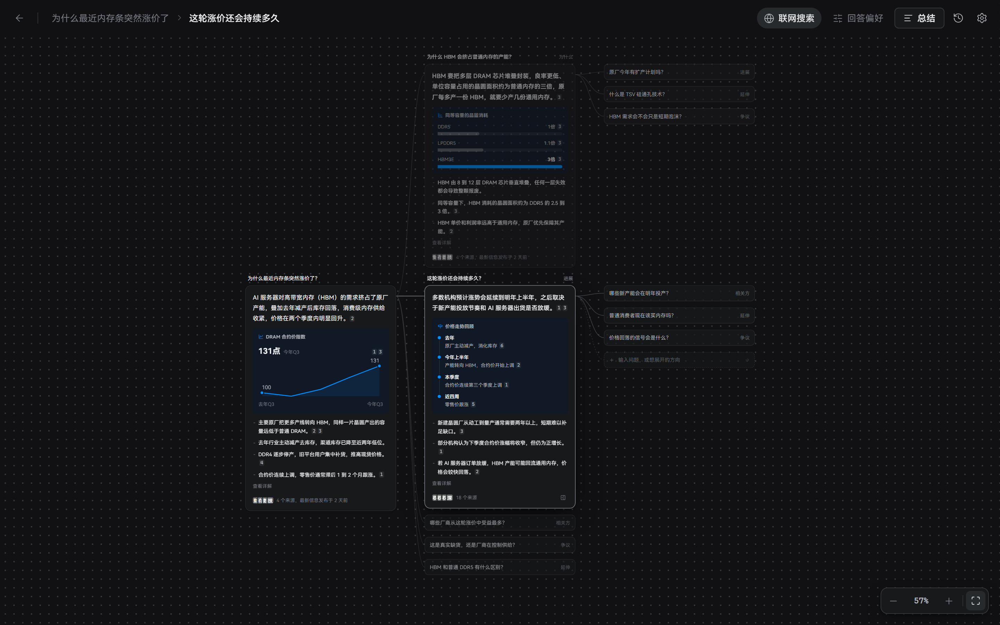

# 知多少

一张会生长的知识地图：在 Windows 和 macOS 上提出一个问题，先得到有来源、标明时效的答案，再顺着它替你想到的下一个问题一层层问下去，问到明白为止。

[下载](https://github.com/henjicc/zhiduoshao/releases/latest) · [快速开始](#快速开始) · [从源码构建](#从源码构建)



## 主要功能

- **有来源的答案**：每次回答先联网检索、筛选来源，结论和要点都标出引用角标和最新信息的日期；点角标可以看到原文里对应的那几句。
- **替你提问**：每个答案后面列出几个值得继续问的问题，标明各自的角度；点开就继续检索、回答，在画布上长成一棵知识树。也可以在任意节点下自己追问。
- **从一句念头开始**：首页可以只写一个纠结或处境，比如“工作三年了，纠结要不要跳槽”，它会先拆出你其实在决定哪几件事，再一件件往下问。
- **合起来看**：多选几个节点，让它总结、找关联或进一步展开；整张地图可以一键生成总结。
- **数据看得见**：有可靠数据时，答案里会附带柱状图、走势图、时间线等小卡片。
- **带图提问**：可以附上最多 4 张图片，比如商品页截图，一起检索和回答。
- **越用越懂你**：在本机记下你常看的网站和关心的角度，用来调整检索和回答；随时可以在设置里查看、修改或关闭。

## 环境要求

| 平台 | 安装包 | 说明 |
| --- | --- | --- |
| Windows 10 / 11（x64） | `zhiduoshao_<版本>_windows_x64-setup.exe` | 需要 WebView2，系统没有时安装程序会自动下载 |
| macOS（Apple 芯片与 Intel） | `zhiduoshao_<版本>_darwin_universal.dmg` | 同一个安装包两种芯片都能用 |

使用前还需要两个腾讯云 API Key：

- **TokenHub 按量 API Key**（大模型）：按用量收费，在 [TokenHub 控制台](https://console.cloud.tencent.com/tokenhub/apikey) 创建。Coding Plan、Token Plan 套餐密钥不能使用。
- **元宝搜索 API Key**（联网检索）：在 [元宝搜索控制台](https://console.cloud.tencent.com/wsapi/index?tab=apikey) 创建。每月有 2000 次免费额度；在控制台填写邀请码 `4PX9W49W`，可额外获得 4000 次。

## 安装

到 [Releases](https://github.com/henjicc/zhiduoshao/releases/latest) 下载对应平台的安装包。

- **Windows**：运行 `.exe` 安装。安装包没有代码签名，SmartScreen 拦截时点“更多信息 → 仍要运行”。
- **macOS**：打开 `.dmg`，把“知多少”拖进“应用程序”。应用没有经过苹果公证，第一次打开被拦时，到“系统设置 → 隐私与安全性”点“仍要打开”。

## 快速开始

1. 打开知多少，点右上角的齿轮进入“设置”，填入 TokenHub 和元宝搜索两个 API Key，点“测试连接”，看到两项都通过即可。
2. 回到首页，输入一个问题，比如“为什么最近内存条突然涨价了？”，按回车。
3. 画布上会出现一张答案卡片：先是结论，然后是要点、来源和时效；卡片右边会出现几个延伸问题。点其中一个，它会接着检索回答，连成第二层。

点一下卡片可以在右侧打开详情，查看全部来源、检索过程和更详细的解释。地图会自动保存，回到首页能在“最近”里找到。

## 数据与隐私

- 没有服务器，也不需要注册账号：应用在你的电脑上直接请求腾讯接口。
- 你的问题、附图和检索到的资料会发送给腾讯 TokenHub 与元宝搜索；需要读全文时，应用会直接访问来源网页。
- API Key、设置、历史地图和个人记忆都只保存在本机的应用数据里，不会上传。Key 以明文保存，请不要在别人能访问的电脑上使用自己的 Key。

## 已知限制

- 只支持腾讯的大模型（TokenHub）和元宝搜索，没有离线模式。
- 历史记录只在本机，不能跨设备同步；没有自动更新，新版本需要到 Releases 手动下载。
- Windows 安装包没有代码签名，macOS 版没有经过公证，首次运行需要手动放行。

## 问题反馈

使用中遇到问题或有建议，请到 [Issues](https://github.com/henjicc/zhiduoshao/issues) 提交，最好附上操作步骤和界面上显示的错误信息（包括错误码与 RequestId）。

## 从源码构建

需要 Node.js 22.12 以上、Rust stable 和 [Tauri 2 的系统依赖](https://v2.tauri.app/start/prerequisites/)。

项目引用的录制探针 `@henjicc/web-replay-probe` 还没有发布到 npm，需要把 [Henji-AI](https://github.com/henjicc/Henji-AI) 仓库克隆到本仓库旁边：

```bash
git clone https://github.com/henjicc/Henji-AI.git
git clone https://github.com/henjicc/zhiduoshao.git
cd zhiduoshao
npm ci
```

常用命令：

| 命令 | 用途 |
| --- | --- |
| `npm run app:dev` | 以开发模式启动桌面应用 |
| `npm run dev` | 只启动前端；复制 `.env.example` 为 `.env` 后，浏览器里用示例数据调界面 |
| `npm run app:build` | 打包安装包，产物在 `src-tauri/target/release/bundle/` |
| `npm run typecheck`、`npm test` | 类型检查与单元测试 |

推送 `v*` 标签时，GitHub Actions 会构建 Windows 与 macOS 安装包并上传到草稿 Release，见 [`.github/workflows/release.yml`](.github/workflows/release.yml)。
